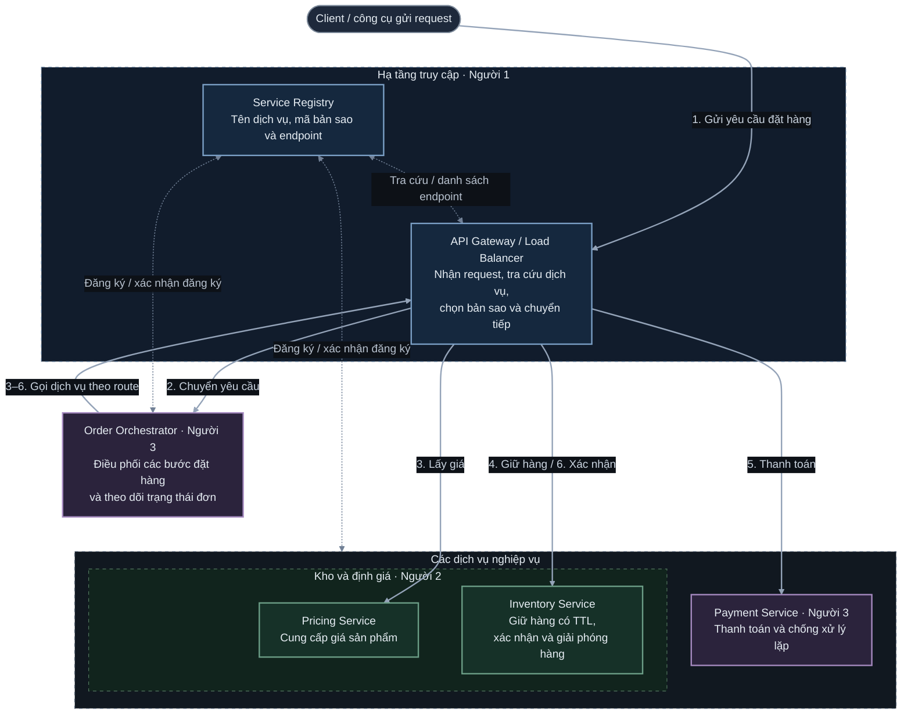

# Sơ đồ kiến trúc tổng thể nền tảng đơn hàng và tồn kho

Tài liệu liên quan: [Đề tài và phân công](DeTai.md) · [Kiến thức nền tảng](KienThucNenTang.md).

Đọc luồng đặt hàng từ trên xuống dưới, theo các bước **1–6**. Mỗi khung nét liền là một chương trình; khung lớn nét đứt nhóm các thành phần liên quan. Inventory và Pricing có thể chạy nhiều bản sao từ cùng chương trình.

- **Khối hạ tầng màu xanh dương:** Registry và Gateway do người 1 phụ trách.
- **Khối kho và định giá màu xanh lá:** Pricing và Inventory do người 2 phụ trách; đặt cạnh nhau theo thứ tự lấy giá rồi giữ hàng.
- **Các chương trình màu tím:** Order Orchestrator và Payment do người 3 phụ trách.
- **Đường liền đậm:** luồng request chính; phản hồi đi ngược chiều tương tác.
- **Đường nét đứt màu xám:** đăng ký/xác nhận đăng ký và tra cứu endpoint với Registry. Đường nối vào khối dịch vụ áp dụng cho từng chương trình bên trong khối.

**Thứ tự nghiệp vụ:** 1. Client gửi yêu cầu → 2. Gateway chuyển đến Order → 3. Lấy giá → 4. Giữ hàng → 5. Thanh toán → 6. Xác nhận hàng. Sau khi các bước thành công, Order hoàn tất đơn và trả kết quả qua Gateway.

Các bước 3–6 do Order quyết định và gửi qua cùng một Gateway. Gateway xác định dịch vụ đích theo route và chọn bản sao bằng round-robin. Việc đăng ký dịch vụ diễn ra khi khởi động; thông tin endpoint được Gateway tra cứu và làm mới theo chính sách của hệ thống.
