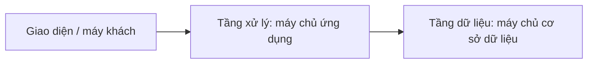
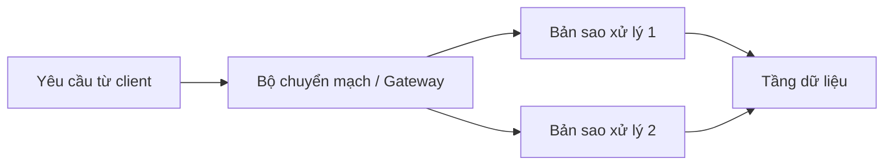

# Kiến thức cần thiết cho Đề tài E: Nền tảng đơn hàng và tồn kho theo SOA

## 1. Nguồn tài liệu và cách đọc

**Giáo trình:** Andrew S. Tanenbaum và Maarten van Steen, *Distributed Systems: Principles and Paradigms*, ấn bản 2, Pearson Prentice Hall, 2007.

**Tệp nguồn:** [Mở giáo trình PDF](<Distributed systems principles and paradigms 2nd edition.pdf>).

**Đi đến:** [Bảng tra cứu](#ban-do-yeu-cau) · [Chương 2](#chuong-2) · [Chương 3](#chuong-3) · [Chương 10](#chuong-10) · [Chương 12](#chuong-12) · [Thanh toán lũy đẳng](#thanh-toan-luy-dang) · [Minh chứng](#noi-dung-can-minh-chung).

Tài liệu này diễn giải bằng tiếng Việt những kiến thức cần dùng cho [đề tài gốc](de-tai-e-nen-tang-don-hang-ton-kho.md#tai-lieu-tham-chieu), tập trung vào Chương 2, 10, 12 và các mục của Chương 3 được dẫn chiếu trong phần phân công.

- **Theo sách:** trình bày nguyên lý và vị trí để tra cứu trong giáo trình.
- **Áp dụng cho đề tài:** ví dụ hoặc đề xuất thiết kế cho hệ thống đơn hàng, tồn kho và thanh toán.
- **Trang sách** là số in trên trang; **trang PDF** là vị trí trong trình đọc PDF. Ví dụ, trang sách 37 tương ứng trang PDF 56. Liên kết `#page=` mở đến vị trí tương ứng nếu trình đọc hỗ trợ.

Các bài giảng 01, 11, 12 chưa được cung cấp nên chưa thể đối chiếu với nội dung giảng dạy. REST/gRPC, tên gọi UDDI-Lite và nghiệp vụ giữ hàng theo TTL là những lựa chọn hoặc cách áp dụng của đề tài; sách trình bày các nguyên lý liên quan.

## 2. Bảng tra cứu theo yêu cầu đề tài

| Yêu cầu trong đề tài gốc | Phần kiến thức cần đọc | Dẫn chiếu trong sách |
|---|---|---|
| [Backend ba tầng, liên kết lỏng](de-tai-e-nen-tang-don-hang-ton-kho.md#muc-tieu-he-thong) | [Kiến trúc và liên kết lỏng](#kien-truc-va-lien-ket-long); [ba tầng](#kien-truc-ba-tang) | Mục 2.1, 2.2.1; Hình 2-6; trang 34–43 |
| [Web Services và khám phá dịch vụ động](de-tai-e-nen-tang-don-hang-ton-kho.md#muc-tieu-he-thong) | [Web Services, UDDI, WSDL, SOAP](#web-services-uddi-wsdl-soap); [đăng ký và khám phá](#dang-ky-va-kham-pha-dich-vu) | Mục 10.3.1, 12.1.2, 12.3.2 |
| [Sinh viên 1: danh bạ và đăng ký endpoint](de-tai-e-nen-tang-don-hang-ton-kho.md#sinh-vien-1) | [Endpoint và binding](#endpoint-va-binding); [đăng ký và khám phá](#dang-ky-va-kham-pha-dich-vu) | Mục 3.4.1, 10.3.1, 12.1.2 |
| [Sinh viên 1: gateway, định tuyến, round-robin](de-tai-e-nen-tang-don-hang-ton-kho.md#sinh-vien-1) | [Bộ chuyển mạch và cân bằng tải](#dinh-tuyen-va-round-robin) | Mục 3.4.2; Hình 3-12; trang 93–95; Mục 12.2.3 |
| [Sinh viên 2: các bản sao backend stateless](de-tai-e-nen-tang-don-hang-ton-kho.md#sinh-vien-2) | [Stateless và soft-state](#stateless-va-soft-state); [nhân bản backend](#nhan-ban-backend) | Mục 3.4.1, 3.4.2, 12.6.3 |
| [Sinh viên 2: giữ hàng có TTL](de-tai-e-nen-tang-don-hang-ton-kho.md#sinh-vien-2) | [Giữ hàng theo TTL](#giu-hang-theo-ttl) | Áp dụng nguyên lý soft-state ở Mục 3.4.1, trang 91 |
| [Sinh viên 3: điều phối đơn hàng](de-tai-e-nen-tang-don-hang-ton-kho.md#sinh-vien-3) | [Tầng xử lý](#kien-truc-ba-tang); [phối hợp dịch vụ](#dieu-phoi-don-hang) | Hình 2-6; Mục 12.1.2, trang 552–554 |
| [Sinh viên 3: thanh toán có tính lũy đẳng](de-tai-e-nen-tang-don-hang-ton-kho.md#sinh-vien-3) | [Tính lũy đẳng](#tinh-luy-dang); [lời gọi bị nhân bản](#loi-goi-bi-nhan-ban); [áp dụng cho thanh toán](#thanh-toan-luy-dang) | Mục 2.2.1, trang 37; Mục 10.6.2, trang 475–477 |
| [Định tuyến thông điệp](de-tai-e-nen-tang-don-hang-ton-kho.md#muc-tieu-he-thong) | [Định tuyến yêu cầu](#dinh-tuyen-va-round-robin); [giao tiếp từ xa](#giao-tiep-va-thong-diep) | Mục 3.4.2, 10.3.5, 12.2.3 |

## 3. Chương 2 — Kiến trúc

### 3.1. Thành phần, giao diện và liên kết lỏng

**Theo sách — Mục 2.1, trang 34–36:** [PDF trang 53](<Distributed systems principles and paradigms 2nd edition.pdf#page=53>).

Kiến trúc phần mềm mô tả các thành phần, giao diện, cách kết nối và dữ liệu trao đổi. Kiến trúc hệ thống còn xác định cách đặt các thành phần lên những máy thực tế. Một thành phần có giao diện rõ ràng có thể được thay thế khi thành phần mới giữ đúng hợp đồng giao tiếp.

Sách giới thiệu kiến trúc phân lớp, dựa trên đối tượng, lấy dữ liệu làm trung tâm và dựa trên sự kiện. Trong kiến trúc sự kiện, bên phát và bên nhận có thể giảm phụ thuộc vào danh tính cụ thể của nhau. Đây là một ví dụ về liên kết lỏng.

**Áp dụng cho đề tài:** xác định hợp đồng giao tiếp riêng cho Registry, Gateway, Inventory, Pricing, Order và Payment. Bên gọi sử dụng tên dịch vụ và hợp đồng; endpoint của từng bản sao được tra cứu khi cần. Nhờ đó, việc thay đổi vị trí chạy của một dịch vụ ít ảnh hưởng đến các dịch vụ khác.

Các hợp đồng cần thống nhất đầu vào, đầu ra, ý nghĩa nghiệp vụ, cách biểu diễn lỗi và quy tắc xử lý yêu cầu lặp; xem thêm [giao diện và proxy](#giao-dien-va-proxy). Lời gọi đồng bộ vẫn tạo phụ thuộc về thời gian đáp ứng giữa các dịch vụ; mức độ liên kết lỏng còn phụ thuộc vào cách thiết kế hợp đồng và xử lý lỗi.

### 3.2. Client–server và kiến trúc ba tầng

**Theo sách — Mục 2.2.1, trang 36–43:** [PDF trang 55](<Distributed systems principles and paradigms 2nd edition.pdf#page=55>). **Hình 2-6, trang 43:** [PDF trang 62](<Distributed systems principles and paradigms 2nd edition.pdf#page=62>).

Client gửi yêu cầu đến server và chờ kết quả. Vai trò này phụ thuộc vào từng tương tác: một server nhận yêu cầu từ bên ngoài có thể tiếp tục đóng vai client để gọi server khác.

Sách tách ứng dụng thành ba nhóm trách nhiệm: giao diện người dùng, xử lý ứng dụng và quản lý dữ liệu. Hình 2-6 minh họa máy chủ ứng dụng vừa phục vụ giao diện, vừa gọi máy chủ cơ sở dữ liệu.

**Áp dụng cho đề tài:** Order Orchestrator xử lý một yêu cầu đặt hàng bằng cách gọi Inventory và Payment. Mỗi dịch vụ quản lý việc truy cập dữ liệu thuộc trách nhiệm của mình. Một tầng có thể gồm nhiều dịch vụ và nhiều bản sao; mô hình ba tầng mô tả cách phân chia trách nhiệm.

Gateway đóng vai trò tiếp nhận và chuyển tiếp yêu cầu ở phía trước backend. Cách tổ chức cụm máy chủ có gateway được giải thích thêm ở [Hình 3-12](#dinh-tuyen-va-round-robin).

### 3.3. Tính lũy đẳng và việc gửi lại yêu cầu

**Theo sách — Mục 2.2.1, trang 37:** [PDF trang 56](<Distributed systems principles and paradigms 2nd edition.pdf#page=56>).

Khi không nhận được phản hồi, client có thể chưa biết yêu cầu đã đến server hay chưa. Có hai tình huống cần phân biệt:

1. Yêu cầu chưa được thực hiện.
2. Server đã thực hiện yêu cầu nhưng phản hồi bị mất.

Nếu client gửi lại yêu cầu trong tình huống thứ hai, tác dụng nghiệp vụ có thể xảy ra thêm một lần. Sách dùng ví dụ giao dịch ngân hàng để giải thích vấn đề này.

Một thao tác có tính lũy đẳng khi thực hiện lại cùng thao tác vẫn giữ tác dụng cuối cùng tương đương với thực hiện một lần. Việc đọc số dư thường cho phép gửi lại an toàn; việc cộng thêm một khoản tiền cần cơ chế kiểm soát tác dụng lặp.

**Áp dụng cho đề tài:** một lần thanh toán logic cần có mã nhận diện ổn định. Các lần gửi lại phải mang cùng mã đó để Payment nhận ra yêu cầu đã được xử lý. Xem [cách áp dụng cho thanh toán](#thanh-toan-luy-dang) và [rủi ro lời gọi bị nhân bản](#loi-goi-bi-nhan-ban).

## 4. Chương 3 — Thiết kế máy chủ và cụm máy chủ

### 4.1. Stateless, soft-state và trạng thái bền vững

**Theo sách — Mục 3.4.1, trang 88–92; phần trạng thái ở trang 90–92:** [PDF trang 109](<Distributed systems principles and paradigms 2nd edition.pdf#page=109>).

| Khái niệm | Ý nghĩa cần nắm | Liên hệ với đề tài |
|---|---|---|
| Stateless | Server xử lý xong yêu cầu mà không cần giữ trạng thái tương tác của client để phục vụ các yêu cầu tiếp theo. Một số thông tin phụ trợ có thể mất mà dịch vụ vẫn hoạt động được. | Một bản sao Inventory hoặc Pricing có thể tiếp nhận yêu cầu độc lập. |
| Soft-state | Server giữ trạng thái cho client trong thời gian giới hạn; khi hết hạn, hệ thống quay lại hành vi mặc định. | Giữ hàng tạm thời đến `expires_at`. |
| Stateful | Server giữ thông tin về client qua nhiều thao tác và cần quản lý việc cập nhật, xóa hoặc phục hồi thông tin đó. | Phiên hoặc quy trình đang thực hiện cần được thiết kế rõ cách lưu trữ và phục hồi. |
| Trạng thái bền vững | Dữ liệu nghiệp vụ cần được lưu lâu dài và phục hồi khi máy chủ khởi động lại. | Đơn hàng, tồn kho đã xác nhận, kết quả thanh toán. |

Sách phân biệt trạng thái phiên với dữ liệu lâu dài trong cơ sở dữ liệu. Một backend stateless vẫn có thể đọc và ghi dữ liệu nghiệp vụ vào kho dữ liệu.

**Áp dụng cho đề tài:** cung cấp đủ thông tin trong mỗi yêu cầu để bản sao backend phù hợp có thể xử lý. Lưu dữ liệu cần dùng chung giữa các bản sao ở nơi có cơ chế truy cập nhất quán. Các trạng thái giữ hàng có thời hạn được quản lý riêng theo [quy tắc TTL](#giu-hang-theo-ttl).

### 4.2. Áp dụng soft-state để giữ hàng theo TTL

**Cơ sở từ sách — Mục 3.4.1, trang 91:** [PDF trang 110](<Distributed systems principles and paradigms 2nd edition.pdf#page=110>).

Sách giải thích nguyên lý trạng thái có thời hạn. Phần dưới đây áp dụng nguyên lý đó cho nghiệp vụ giữ hàng của đề tài.

Một bản ghi giữ hàng có thể gồm `reservation_id`, `order_id`, `sku`, `quantity`, `expires_at` và trạng thái. Vòng đời gợi ý:

1. **Tạo giữ hàng:** kiểm tra lượng còn có thể bán và ghi nhận phần hàng được giữ trong cùng một thao tác có kiểm soát đồng thời.
2. **Trong thời hạn:** lượng hàng đang giữ được tính vào phần chưa thể cấp cho yêu cầu khác.
3. **Xác nhận:** nếu đơn hàng hoàn tất đúng điều kiện, chuyển giữ hàng thành lượng hàng đã bán.
4. **Hết hạn hoặc hủy:** giải phóng lượng đang giữ để có thể bán lại.

Trong mô hình đơn giản, lượng có thể bán bằng lượng tồn kho chưa bán trừ đi tổng lượng đang được giữ hợp lệ. Cần quy định rõ cách lưu từng đại lượng để một thay đổi trạng thái chỉ điều chỉnh tồn kho một lần.

Các tình huống cần thiết kế gồm: hai bản sao cùng giữ mặt hàng cuối cùng; xác nhận diễn ra đồng thời với hết hạn; yêu cầu hủy hoặc xác nhận bị gửi lại. Việc xử lý phải dựa trên trạng thái và thời điểm hết hạn có thẩm quyền của hệ thống.

TTL xác định thời điểm giữ hàng mất hiệu lực về nghiệp vụ. Cơ chế dọn bộ nhớ đệm có thể chạy sau thời điểm đó, nên thao tác sử dụng giữ hàng vẫn cần kiểm tra `expires_at`. Cách thiết kế phải bảo toàn lượng tồn kho ngay cả khi bộ nhớ đệm hoặc một bản sao backend khởi động lại.

### 4.3. Bộ chuyển mạch, định tuyến và round-robin

**Theo sách — Mục 3.4.2, Hình 3-12, trang 93; round-robin ở trang 95:** [PDF trang 112](<Distributed systems principles and paradigms 2nd edition.pdf#page=112>), [PDF trang 114](<Distributed systems principles and paradigms 2nd edition.pdf#page=114>). **Bổ sung — Mục 12.2.3, trang 558–559:** [PDF trang 577](<Distributed systems principles and paradigms 2nd edition.pdf#page=577>).

Hình 3-12 tổ chức cụm máy chủ thành ba tầng: bộ chuyển mạch tiếp nhận yêu cầu, các máy chủ xử lý và hệ thống lưu trữ. Client sử dụng điểm truy cập phía trước; bộ chuyển mạch quyết định chuyển yêu cầu đến máy chủ phù hợp.

Round-robin lần lượt chọn các máy chủ trong danh sách, rồi quay lại đầu danh sách. Với ba bản sao cùng một dịch vụ, thứ tự có thể là `A → B → C → A → ...`.

Sách còn phân biệt chuyển tiếp ở tầng vận chuyển với định tuyến dựa trên nội dung ở tầng ứng dụng. Gateway có thể đọc thông tin yêu cầu để chọn dịch vụ cần xử lý.

**Áp dụng cho đề tài:** định tuyến gồm hai bước: xác định đúng dịch vụ từ yêu cầu, sau đó chọn một bản sao của dịch vụ đó bằng round-robin. Ví dụ, yêu cầu tồn kho được chọn trong nhóm Inventory; yêu cầu định giá được chọn trong nhóm Pricing.

Registry cung cấp thông tin các bản sao; Gateway sử dụng thông tin đó để chọn đích. Cần xác định cách cập nhật danh sách khi một bản sao gia nhập hoặc ngừng hoạt động. Khi gặp lỗi, việc thử lại một thao tác có tác dụng nghiệp vụ phải tuân theo [quy tắc lũy đẳng](#tinh-luy-dang).

### 4.4. Nhân bản backend và vị trí lưu trạng thái

**Theo sách — Mục 3.4.2 và Mục 12.2.3:** [PDF trang 112](<Distributed systems principles and paradigms 2nd edition.pdf#page=112>), [PDF trang 577](<Distributed systems principles and paradigms 2nd edition.pdf#page=577>).

Chạy nhiều bản sao của cùng chức năng giúp phân phối yêu cầu đến nhiều máy chủ. Đối với đề tài, Inventory và Pricing có thể có nhiều bản sao xử lý được Gateway lựa chọn.

**Áp dụng cho đề tài:** thiết kế riêng hai việc: nhân bản tiến trình xử lý và quản lý dữ liệu mà các tiến trình cùng sử dụng. Nếu cùng một mặt hàng được xử lý bởi nhiều bản sao, quyết định giữ hoặc trừ hàng phải dựa trên trạng thái tồn kho nhất quán. Tương tự, các bản sao Payment cần nhận biết chung một yêu cầu thanh toán đã hoàn tất.

Các bản sao backend có thể sử dụng chung một kho trạng thái; nếu nhân bản cả dữ liệu thì cần thêm cơ chế duy trì nhất quán. Xem [nhân bản dữ liệu ứng dụng web](#nhan-ban-va-nhat-quan) và [lời gọi bị nhân bản](#loi-goi-bi-nhan-ban).

## 5. Chương 10 — Hệ thống phân tán dựa trên đối tượng

Chương này cung cấp nền tảng về giao diện, lời gọi từ xa, tìm vị trí đối tượng và nhân bản lời gọi. Các ví dụ CORBA, Java và Globe giúp giải thích nguyên lý; đề tài cho phép lựa chọn giao thức dịch vụ khác để áp dụng các nguyên lý đó.

### 5.1. Giao diện, proxy và lời gọi từ xa

**Theo sách — Mục 10.1.1, trang 444–445:** [PDF trang 463](<Distributed systems principles and paradigms 2nd edition.pdf#page=463>).

Đối tượng đóng gói trạng thái và cung cấp các phương thức qua giao diện. Trong mô hình đối tượng từ xa, client sử dụng proxy ở phía mình; proxy đóng gói tham số thành thông điệp gửi qua mạng. Phía server giải mã thông điệp, gọi phần cài đặt và đóng gói kết quả trả về.

Việc tách giao diện khỏi phần cài đặt giúp client sử dụng một hợp đồng ổn định trong khi bên cung cấp có thể thay đổi cách thực hiện. Giao tiếp từ xa còn cần thống nhất cách mã hóa dữ liệu và biểu diễn lỗi.

**Áp dụng cho đề tài:** mô tả rõ các thao tác như giữ hàng, xác nhận giữ hàng, lấy giá và thanh toán. Ví dụ tên thao tác có thể là `ReserveStock`, `ConfirmReservation`, `GetPrice`, `ChargePayment`; đây là ví dụ hợp đồng cho đề tài. Dữ liệu truyền giữa các dịch vụ cần có định danh đơn hàng và định danh thao tác để liên kết các bước xử lý.

### 5.2. Endpoint, binding và tìm vị trí dịch vụ

**Theo sách — Mục 10.3.1, trang 456–458:** [PDF trang 475](<Distributed systems principles and paradigms 2nd edition.pdf#page=475>). **Liên quan — Mục 3.4.1, trang 89:** [PDF trang 108](<Distributed systems principles and paradigms 2nd edition.pdf#page=108>).

Binding là quá trình liên kết phía gọi với đối tượng đích để có thể thực hiện lời gọi. Hệ thống cần biết vị trí máy chủ, endpoint và giao thức thích hợp. Binding có thể diễn ra ngầm hoặc được client thực hiện qua một bước riêng.

Sách giải thích hạn chế của việc gắn cứng địa chỉ: endpoint có thể thay đổi sau khi khởi động lại, còn máy chủ có thể di chuyển sang máy khác. Một daemon hoặc dịch vụ vị trí có thể duy trì ánh xạ từ định danh ổn định sang địa chỉ hiện tại.

**Áp dụng cho đề tài:** dùng tên dịch vụ ổn định, chẳng hạn `inventory`, để tra danh sách endpoint hiện tại. Mỗi tiến trình backend đăng ký địa chỉ khi khởi động; bên gọi hoặc Gateway phân giải tên dịch vụ trước khi chuyển yêu cầu. Đây là cơ sở để thiết kế [Registry và khám phá dịch vụ động](#dang-ky-va-kham-pha-dich-vu).

### 5.3. Giao tiếp đồng bộ, bất đồng bộ và thông điệp

**Theo sách — Mục 10.3 và 10.3.5, đặc biệt trang 464–466:** [PDF trang 483](<Distributed systems principles and paradigms 2nd edition.pdf#page=483>).

Trong lời gọi đồng bộ, bên gọi chờ kết quả. Với lời gọi bất đồng bộ, bên gọi có thể tiếp tục làm việc và nhận kết quả sau, chẳng hạn qua callback hoặc hỏi trạng thái. Sách minh họa các cách này bằng CORBA messaging.

**Áp dụng cho đề tài:** chuỗi Order → Inventory → Payment có thể bắt đầu bằng giao tiếp đồng bộ. Nếu chọn bất đồng bộ, cần mô tả rõ thông điệp nào kích hoạt bước tiếp theo và cách ghép phản hồi về đúng đơn hàng.

Trong cả hai cách, cần phân biệt một lần gửi thông điệp với một thao tác nghiệp vụ. Nhiều lần gửi có thể đại diện cho cùng một thao tác đang được thử lại. Gateway định tuyến thông điệp đến dịch vụ phù hợp theo [quy tắc định tuyến](#dinh-tuyen-va-round-robin).

### 5.4. Rủi ro lời gọi bị nhân bản

**Theo sách — Mục 10.6.2, trang 475–477:** [PDF trang 494](<Distributed systems principles and paradigms 2nd edition.pdf#page=494>).

Sách xét chuỗi A gọi B, rồi B gọi C. Khi B có nhiều bản sao cùng thực hiện lời gọi, C có thể bị gọi nhiều lần cho cùng một công việc. Nếu lời gọi ở C tạo tác dụng như chuyển tiền, việc nhân bản làm phát sinh tác dụng nghiệp vụ lặp.

Một hướng được sách trình bày là nhận diện thống nhất lời gọi và phối hợp các bản sao để kiểm soát việc chuyển tiếp. Vấn đề này bổ sung cho rủi ro gửi lại yêu cầu do mất phản hồi ở Mục 2.2.1.

**Áp dụng cho đề tài:** thiết kế khả năng nhận diện cùng một lần thanh toán trên toàn bộ các bản sao Payment. Một bảng ghi nhớ trong bộ nhớ của riêng một tiến trình chỉ có phạm vi hiệu lực tại tiến trình đó; cơ chế chống tính tiền lặp cần phù hợp với phạm vi nhân bản và yêu cầu phục hồi của hệ thống.

## 6. Chương 12 — Hệ thống web phân tán

### 6.1. Web Services, UDDI, WSDL và SOAP

**Theo sách — Mục 12.1.2, trang 551–554:** [PDF trang 570](<Distributed systems principles and paradigms 2nd edition.pdf#page=570>). **SOAP — Mục 12.3.2, trang 566–567:** [PDF trang 585](<Distributed systems principles and paradigms 2nd edition.pdf#page=585>).

Web Services cho phép một ứng dụng sử dụng chức năng của ứng dụng khác qua mạng theo các quy ước chung. Sách nhấn mạnh việc chuẩn hóa mô tả dịch vụ, tra cứu, giao tiếp và phối hợp giữa các dịch vụ.

| Thành phần | Vai trò theo sách | Liên hệ với đề tài |
|---|---|---|
| UDDI | Tổ chức danh bạ chứa mô tả để ứng dụng có thể tìm dịch vụ. | Cơ sở ý tưởng cho Registry UDDI-Lite. |
| WSDL | Mô tả giao diện dịch vụ, kiểu dữ liệu và thông tin cần để gọi; có thể phục vụ sinh stub. | Hợp đồng giao tiếp khi chọn hướng SOAP/WSDL. |
| SOAP | Khuôn khổ thông điệp có cấu trúc XML; có phần thân và phần thông tin điều khiển trong envelope. | Giao tiếp giữa các dịch vụ theo nhánh SOAP của đề tài. |

SOAP có thể được ánh xạ lên giao thức truyền tải; sách mô tả việc sử dụng HTTP phổ biến. Mô tả dịch vụ, tìm dịch vụ và truyền thông điệp là những trách nhiệm liên quan cần được thiết kế đồng bộ.

**Áp dụng cho đề tài:** nếu chọn REST hoặc gRPC, vẫn cần thống nhất hợp đồng, định danh dịch vụ, cách tra endpoint, cách biểu diễn lỗi và cách xử lý yêu cầu lặp. Đây là cách vận dụng các nguyên lý của sách cho lựa chọn giao thức mà đề tài cho phép.

### 6.2. Áp dụng cho đăng ký và khám phá dịch vụ động

**Cơ sở từ sách:** danh bạ dịch vụ ở Mục 12.1.2, trang 551–552, kết hợp với [endpoint và binding](#endpoint-va-binding).

Luồng tối thiểu phù hợp với yêu cầu của sinh viên 1:

1. Backend khởi động và đăng ký tên dịch vụ, định danh bản sao, endpoint với Registry.
2. Registry lưu các endpoint hiện có theo từng dịch vụ.
3. Gateway hoặc bên gọi tra cứu dịch vụ cần dùng.
4. Gateway chọn một bản sao phù hợp rồi chuyển yêu cầu đến endpoint được chọn.
5. Khi tập bản sao thay đổi, thông tin tra cứu được cập nhật theo chính sách đã thống nhất.

Trong đề tài, UDDI-Lite có thể được thiết kế như danh bạ nhỏ phục vụ tập dịch vụ của nhóm. Cần mô tả rõ những trường thông tin, thao tác đăng ký/tra cứu và chính sách loại bỏ endpoint không còn hoạt động. Các chi tiết này là quyết định thiết kế của nhóm.

Có thể dùng đăng ký lại định kỳ kèm thời hạn hiệu lực, hoặc cơ chế kiểm tra tình trạng hoạt động. Nếu Gateway lưu đệm kết quả tra cứu thì cần quy định khi nào làm mới danh sách. Registry cung cấp thông tin vị trí; [Gateway thực hiện lựa chọn đích và định tuyến](#dinh-tuyen-va-round-robin).

### 6.3. Tổng hợp và phối hợp dịch vụ cho đơn hàng

**Theo sách — Mục 12.1.2, phần phối hợp Web Services, trang 552–554:** [PDF trang 571](<Distributed systems principles and paradigms 2nd edition.pdf#page=571>).

Một dịch vụ hoàn chỉnh có thể được tạo từ nhiều dịch vụ nhỏ. Sách dùng ví dụ cửa hàng trực tuyến kết hợp lựa chọn hàng, thanh toán và giao hàng. Các thành phần phải phối hợp để người dùng nhìn thấy một quy trình thống nhất.

Phần phối hợp cần làm rõ các bên tham gia, vai trò của từng bên, thứ tự tương tác và định danh của từng phiên thực hiện quy trình. Sách giới thiệu chuẩn hóa phối hợp và lấy giao thức 2PC làm một ví dụ.

**Áp dụng cho đề tài:** Order Orchestrator chịu trách nhiệm theo dõi tiến độ đơn hàng và gọi Inventory, Payment theo một luồng đã xác định. Một luồng minh họa:

1. Tiếp nhận yêu cầu và tạo định danh đơn hàng.
2. Lấy giá cần dùng và yêu cầu giữ hàng có thời hạn.
3. Gửi yêu cầu thanh toán với mã chống xử lý lặp ổn định.
4. Xác nhận giữ hàng và hoàn tất đơn khi các điều kiện nghiệp vụ được đáp ứng.
5. Nếu có lỗi hoặc kết quả chưa rõ, lưu trạng thái để tiếp tục, đối soát hoặc xử lý bù theo quy tắc của nhóm.

Luồng này cần quy định trước cách xử lý thanh toán thất bại, thanh toán thành công nhưng phản hồi bị mất, và giữ hàng hết hạn trước khi xác nhận. Trường hợp đã thanh toán nhưng không thể xác nhận hàng cần có bước xử lý bù hoặc hoàn tiền được theo dõi đến khi hoàn tất.

Ví dụ 2PC trong sách cung cấp một cách nhìn về phối hợp. Đề tài chưa quy định giao thức giao dịch cụ thể; nhóm cần chọn cơ chế phù hợp và giải thích cách xử lý các trạng thái dở dang.

### 6.4. Nhân bản dữ liệu và tính nhất quán của ứng dụng web

**Theo sách — Mục 12.6.3, trang 579–582:** [PDF trang 598](<Distributed systems principles and paradigms 2nd edition.pdf#page=598>).

Nhân bản và lưu đệm có thể cải thiện hiệu năng ứng dụng web, nhưng cần xét tỷ lệ đọc/ghi và chi phí giữ các bản sao dữ liệu nhất quán. Sách phân tích các cách sao chép toàn bộ hoặc một phần dữ liệu, cùng vai trò của nơi xử lý cập nhật có thẩm quyền.

**Áp dụng cho đề tài:** giá hiển thị và số lượng tồn kho có thể có yêu cầu về độ mới khác nhau. Nhóm cần xác định thời điểm chốt giá, nơi quyết định lượng hàng có thể giữ và cách các bản sao backend cùng nhìn thấy quyết định đó. Yêu cầu đọc từ bộ nhớ đệm và yêu cầu làm thay đổi tồn kho cần có quy tắc dữ liệu phù hợp với tác dụng nghiệp vụ của chúng.

## 7. Áp dụng tổng hợp: thanh toán có tính lũy đẳng

**Cơ sở:** [Mục 2.2.1 về tính lũy đẳng](#tinh-luy-dang), [Mục 10.6.2 về lời gọi bị nhân bản](#loi-goi-bi-nhan-ban), [Mục 12.1.2 về phối hợp dịch vụ](#dieu-phoi-don-hang).

Đây là gợi ý thiết kế cho yêu cầu của sinh viên 3. Cơ chế cần bảo đảm rằng cùng một lần thanh toán logic, dù được gửi nhiều lần hoặc đến các bản sao khác nhau, chỉ tạo một tác dụng tính tiền.

| Thông tin | Mục đích |
|---|---|
| `operation_id` hoặc khóa chống lặp | Nhận diện ổn định một lần thanh toán logic qua các lần gửi lại. |
| `order_id`, số tiền và các thuộc tính giao dịch | Xác định nội dung yêu cầu; phát hiện trường hợp dùng lại khóa cho yêu cầu khác. |
| Trạng thái xử lý | Phân biệt chưa thực hiện, đang thực hiện, đã có kết quả hoặc chưa xác định được kết quả. |
| Kết quả đã ghi nhận | Cho phép trả lại kết quả của cùng thao tác khi nhận yêu cầu lặp. |

Luồng xử lý gợi ý:

1. Order tạo khóa ổn định cho lần thanh toán và giữ nguyên khóa khi thử lại.
2. Payment kiểm tra hoặc đăng ký quyền xử lý khóa bằng cơ chế có kiểm soát đồng thời giữa các bản sao.
3. Nếu thao tác đã hoàn tất, trả lại kết quả đã lưu. Nếu đang thực hiện hoặc chưa rõ kết quả, xử lý theo chính sách trạng thái đã thống nhất.
4. Gắn việc ghi nhận tác dụng thanh toán với bản ghi chống lặp bằng cơ chế bảo đảm tính nguyên tử hoặc phục hồi phù hợp.
5. Nếu có hệ thống thanh toán bên ngoài, cần duy trì định danh xuyên suốt và xử lý được khoảng trống giữa kết quả ở bên ngoài với bản ghi cục bộ.

Mất phản hồi sau khi thanh toán thành công là tình huống quan trọng để kiểm chứng. Khi yêu cầu được gửi lại, hệ thống phải nhận diện cùng thao tác và trả kết quả phù hợp. Với yêu cầu chống tính tiền lặp, thời gian lưu bản ghi chống lặp phải phù hợp với phạm vi gửi lại và đối soát; chính sách này cần được thiết kế riêng với TTL giữ hàng.

## 8. Nội dung cần trình bày hoặc minh chứng khi thực hiện đề tài

| Phần việc | Minh chứng gợi ý để thể hiện đã áp dụng kiến thức |
|---|---|
| Kiến trúc chung | Sơ đồ trách nhiệm ba tầng, các hợp đồng dịch vụ và vị trí lưu dữ liệu nghiệp vụ. |
| Registry và khám phá dịch vụ | Backend tự đăng ký khi khởi động; tra cứu được nhiều bản sao; thông tin thay đổi khi tập backend thay đổi. |
| Gateway và round-robin | Yêu cầu được chuyển đúng dịch vụ, sau đó phân phối luân phiên giữa các bản sao của dịch vụ đó. |
| Backend stateless | Các bản sao xử lý được yêu cầu mà không phụ thuộc vào phiên cục bộ của một bản sao cụ thể. |
| Giữ hàng theo TTL | Giữ hàng có hiệu lực trong thời hạn; hết hạn giải phóng đúng lượng; các yêu cầu đồng thời không làm giữ vượt tồn kho. |
| Order Orchestrator | Theo dõi được chuỗi Inventory–Payment và xử lý rõ các nhánh lỗi hoặc kết quả chưa xác định. |
| Payment lũy đẳng | Gửi lại cùng yêu cầu, kể cả qua bản sao khác hoặc sau khi mất phản hồi, vẫn chỉ tạo một tác dụng thanh toán. |

Các minh chứng trên là gợi ý vận dụng những yêu cầu đã có trong đề tài. [Quay lại tài liệu đề tài gốc](de-tai-e-nen-tang-don-hang-ton-kho.md).
